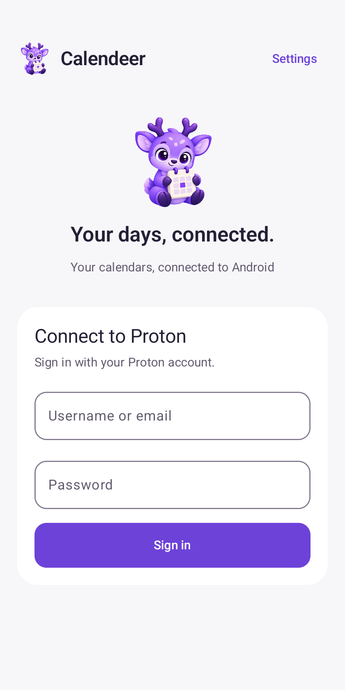
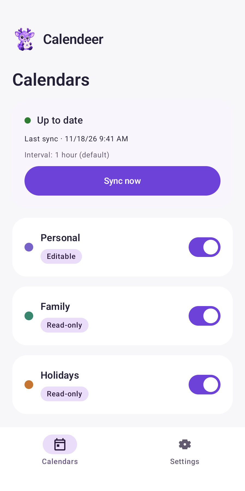
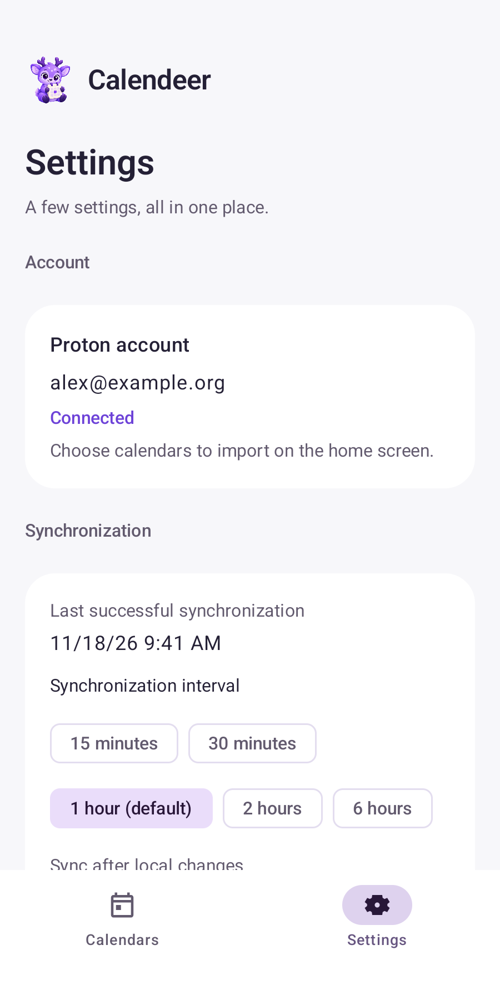

<p align="center">
  
</p>

# Calendeer

Calendeer syncs Proton Calendar with the Android Calendar Provider. It lets you
see Proton events alongside your other calendars in the calendar app you already
use. That app handles event editing and reminders. Calendeer is an independent
open-source project and requires Android 12 or later and a Proton account.

**Availability.** Calendeer is in development. You can build it from source.
An F-Droid submission is planned after several weeks of daily use and review
of a release candidate. [Distribution plan](docs/FDROID.md)

## A look inside

| Sign in | Calendars | Sync settings |
| :---: | :---: | :---: |
|  |  |  |

Screenshots use fictional account and calendar data.

## Connect a calendar

1. Open Calendeer and sign in to Proton. Complete any verification requested
   by Proton. Settings show the connected account.
2. Grant calendar access and enable the calendars you want on this device.
   Each starts in **Read-only** mode. Open your usual agenda and make those
   calendars visible there if necessary.
3. To send supported changes back to a calendar you own, select **Editable** for
   that calendar. In your agenda, select that calendar when creating an event.
   Use **Synchronize** in Calendeer to request an update and check its status.

## What synchronizes

| In your Android calendar | Current support |
| --- | --- |
| View events offline | Selected events, times, all-day dates, locations, descriptions, supported recurrences, personal reminders and event colors. Settings can display the calendar color instead. |
| Edit ordinary personal events | Create, edit and delete supported events. Editing covers title, description, location, date, time zone, personal reminders and colors from Proton’s palette. |
| Edit a repeating event | Create or edit a whole personal daily series with 2–366 occurrences and an interval of 1–365 days. Whole-series edits require a series without individual exceptions and unambiguous times. |
| Edit one occurrence, delete a series or change guests | These outgoing operations are still in development. Unsupported changes stay on the phone and the affected calendar shows their status. Invitations and cancellations are outside the current release profile. |

Changes can be captured offline. Background sync requests run hourly by default
and Android controls when work runs. Settings offer intervals from 15 minutes to
6 hours. Automatic push follows Android’s sync switches. If a request may already
have reached Proton, Calendeer keeps it pending until the result can be verified.
Simultaneous edits on the phone and in Proton can still conflict.
[Sync settings](docs/SYNC_SCHEDULING.md) · [Implementation status](docs/STATUS.md)

Settings offer English, French, German, Italian, Dutch, Polish, Portuguese and
Spanish. You can follow the system language and light/dark theme or choose your own.

## What calendar access means

Calendeer writes the selected events into Android’s shared Calendar Provider.
This requires Android calendar write permission even in Read-only mode. Apps
with calendar access can read the local event details, and your calendar app
controls what appears in reminders and on the lock screen. Proton’s encryption
does not extend to the copy exposed through Android’s calendar API.

Signing out clears the Proton session. If calendar permission is missing,
Calendeer finishes removing its calendar copies when access returns.
[Android permissions](docs/PERMISSIONS.md)

## Build

Use JDK 21, Android SDK platform `platforms;android-37.0` and Build Tools
`36.0.0`. Set the SDK in `local.properties` or `ANDROID_HOME`. First rebuild the Proton native dependency with the
[Linux reference builder](proton-auth/native/golib/README.md) (Go 1.27.1, NDK r27c);
Gradle refuses a missing or altered native artifact. Then run:

```sh
bash gradlew --dependency-verification strict :sync:test :auth:test :proton-auth:testDebugUnitTest :app:testDebugUnitTest :app:assembleDebug :app:lintDebug
```

Use `gradlew.bat` on Windows. The debug APK is generated under
`app/build/outputs/apk/debug/`. See [validation](docs/VALIDATION.md) and the
[dependency update procedure](docs/BUILD_SECURITY.md).

## License

Original contributions use [GPL-3.0-or-later](LICENSE). Imported Proton adaptations
retain GPL-3.0-only terms, so the combined application is distributed under GPL
version 3. See [licensing](docs/LICENSING.md) and the notices in
[docs/licenses](docs/licenses).

## Contributing

For a bug report, include the Calendeer version or source revision, Android
version, calendar app, sync mode, and steps to reproduce with a fictional event.
Keep account addresses, calendar contents, share links, session data and raw
device logs out of public reports. [Issue tracker](https://github.com/patmanak/calendeer/issues)

For code changes, start from the accepted behavior and use the focused checks for
the affected module. [Specification](docs/SPECIFICATION.md) ·
[Architecture](docs/ARCHITECTURE.md) · [Working method](docs/WORKFLOW.md)
